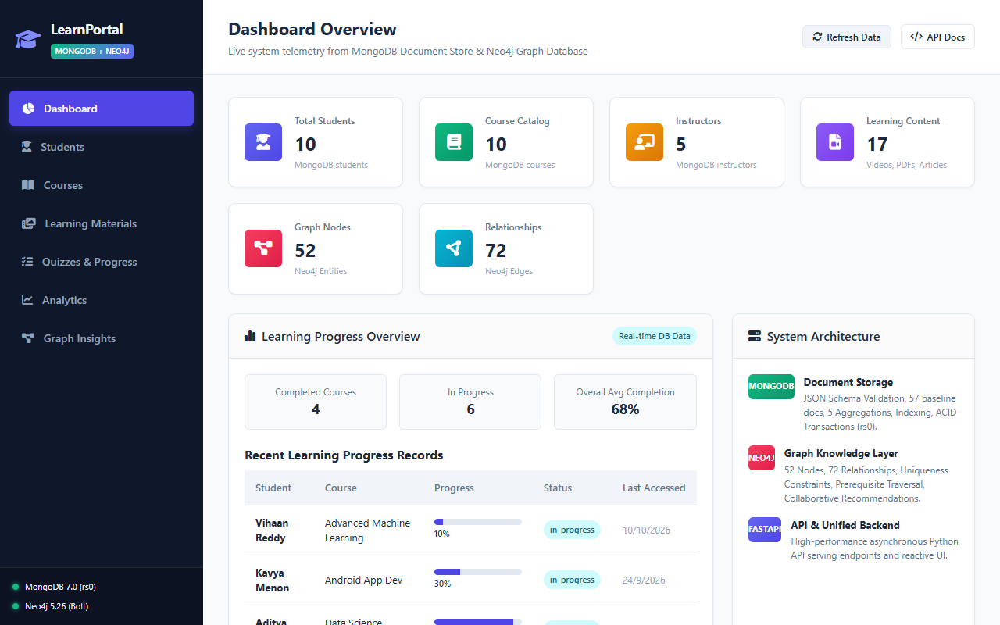
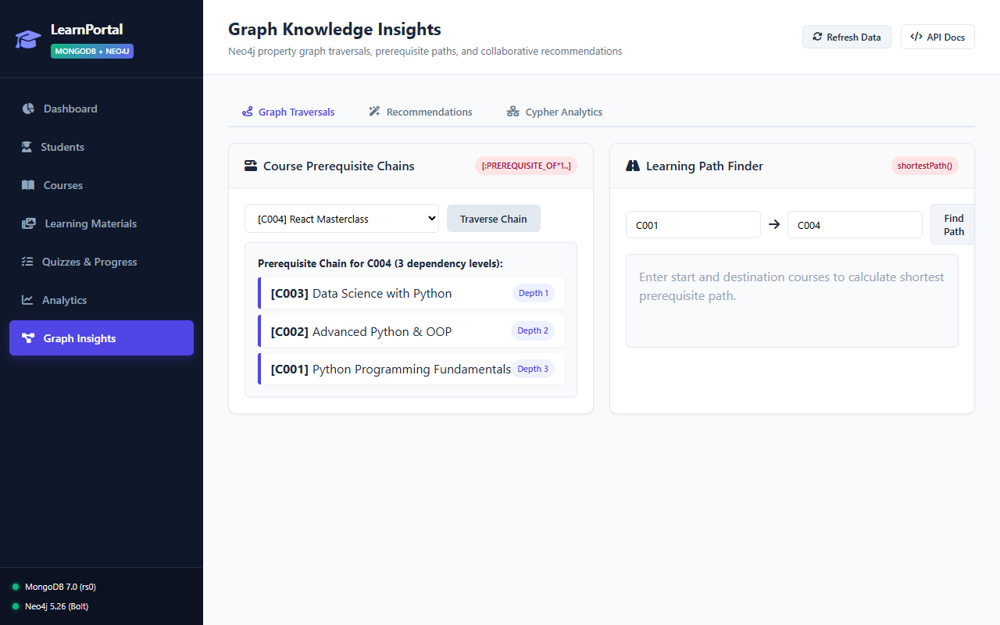
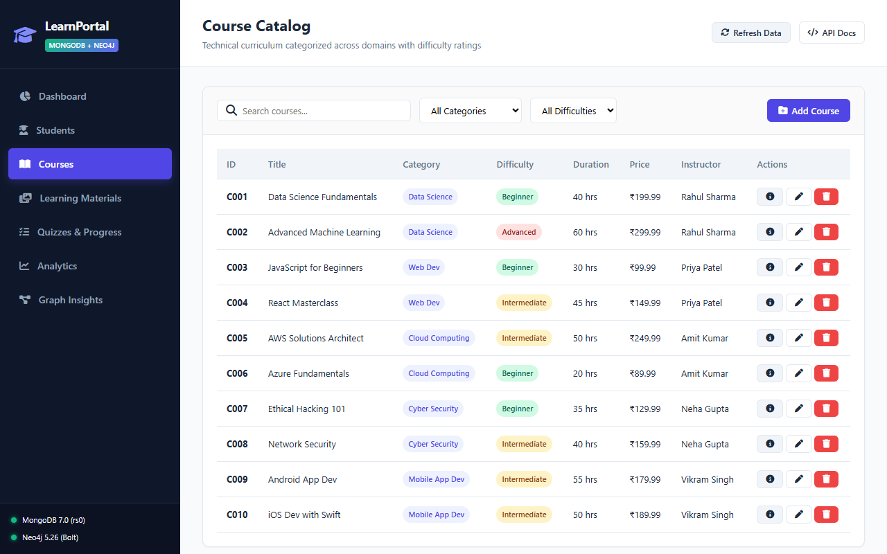
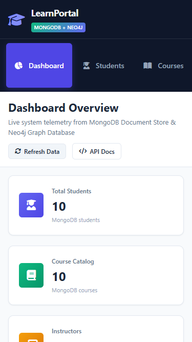

# Online Learning Portal – Hybrid MongoDB and Neo4j NoSQL Database System

[](https://www.python.org/)
[](https://fastapi.tiangolo.com/)
[-47A248.svg)](https://www.mongodb.com/)
[-008CC1.svg)](https://neo4j.com/)
[]()

A full-stack hybrid NoSQL database management system implementing an **Online Learning Portal**. The architecture pairs **MongoDB** (document database with replica set ACID transactions and aggregation pipelines) with **Neo4j** (property graph database for prerequisite traversals, shortest learning paths, and collaborative recommendations), exposed via a high-performance **FastAPI** backend and an interactive single-page application (SPA).

---

## 📸 Application Preview

| **Interactive Portal Dashboard** | **Neo4j Graph Insights & Traversals** |
|:---:|:---:|
|  |  |

| **Course Catalog & Filtering** | **Responsive Mobile Layout** |
|:---:|:---:|
|  |  |

*For complete visual walkthroughs and step-by-step guides, see the [Full-Stack User Guide](docs/full_stack_user_guide.md).*

---

## 🌟 Key Features & Technology Stack

### Technology Stack
- **Database Layer (Document):** MongoDB 7.x (Replica Set `rs0` for multi-document ACID transactions, JSON Schema validation)
- **Database Layer (Graph):** Neo4j 5.x Community / Aura (Cypher query language, constraint-backed property graph)
- **Backend Framework:** FastAPI, Uvicorn, Pydantic v2, PyMongo 4.9+, Neo4j Python Driver 5.25+
- **Frontend Architecture:** Vanilla ES6+ JavaScript, CSS3 Design System with responsive media queries, HTML5, Font Awesome
- **Testing & QA:** Playwright Chromium / Microsoft Edge for browser automation, Requests / Pytest for API verification

### Core Portal Features
- **Live Database Telemetry:** Real-time health monitors polling MongoDB replica set status, Neo4j connectivity, and query latencies.
- **Student Profile & Dual-Write Enrollment:** Synchronizes document changes in MongoDB with relationship edges in Neo4j.
- **Dynamic Course Catalog:** Multi-factor filtering across subject categories and difficulty levels.
- **Learning Materials & Content Delivery:** Structured multi-format tracking (Video, PDF, Notes) linked to course curricula.
- **Assessment Quizzes & Progress Management:** Real-time student progress tracking with an interactive progress slider.
- **MongoDB Aggregation Analytics:** 5 live multi-stage aggregation pipelines and real-time execution plan comparisons (`COLLSCAN` vs `IXSCAN`).
- **Neo4j Graph Traversal & Cypher Analytics:**
  - Variable-length prerequisite dependency tree exploration (`[:PREREQUISITE_OF*1..]`).
  - Shortest learning path algorithm (`shortestPath()`).
  - Collaborative filtering course recommendations based on peer enrollment cohorts.
  - Student skill gap analysis comparing enrolled course prerequisites against acquired skills.
  - Course popularity and instructor teaching workload analytics.

---

## 🏛️ Hybrid NoSQL Architecture

```
                                  ┌───────────────────────────┐
                                  │   Web Browser (Desktop /  │
                                  │      Mobile Viewports)    │
                                  └─────────────┬─────────────┘
                                                │ HTTP / JSON
                                                ▼
                                  ┌───────────────────────────┐
                                  │   FastAPI Web Server      │
                                  │  (Uvicorn @ 127.0.0.1)    │
                                  └──────┬─────────────┬──────┘
                                         │             │
                    PyMongo (rs0 Session)│             │ Neo4j Bolt Driver
                                         ▼             ▼
  ┌──────────────────────────────────────────┐     ┌──────────────────────────────────────────┐
  │        MongoDB (Document Store)          │     │          Neo4j (Graph Database)          │
  ├──────────────────────────────────────────┤     ├──────────────────────────────────────────┤
  │ Collections:                             │     │ Node Labels:                             │
  │ • students (Profile, enrolled courses)   │     │ • :Student     • :Course                 │
  │ • courses (Catalog, pricing, duration)   │     │ • :Instructor  • :Skill                  │
  │ • instructors (Specialization, ratings)  │     │ • :Category                              │
  │ • learning_materials (Video, PDF, notes) │     │                                          │
  │ • quizzes (Assessment questions, points) │     │ Relationship Types:                      │
  │ • progress (Completion %, quiz attempts) │     │ • [:ENROLLED_IN]     • [:COMPLETED]      │
  │                                          │     │ • [:PREREQUISITE_OF] • [:TEACHES]        │
  │ Features: JSON Schema, 5 Aggregations,   │     │ • [:HAS_SKILL]       • [:REQUIRES_SKILL] │
  │ Indexing Explain, ACID Transactions      │     │ • [:BELONGS_TO]                          │
  └──────────────────────────────────────────┘     └──────────────────────────────────────────┘
```

---

## 📊 Verified Database Baseline State

All tests and application features are verified against a standardized baseline:

| Database | Entity / Collection | Count | Description |
|:---|:---|:---:|:---|
| **MongoDB** | `students` | 10 | Student profiles with enrolled courses |
| **MongoDB** | `courses` | 10 | Courses with instructor IDs, price, duration, category |
| **MongoDB** | `instructors` | 5 | Faculty profiles, ratings, specializations |
| **MongoDB** | `learning_materials` | 17 | Modules categorized by video, PDF, and notes |
| **MongoDB** | `quizzes` | 5 | Assessments with questions and maximum point values |
| **MongoDB** | `progress` | 10 | Course progress records with completion percentages |
| **MongoDB** | **Total Documents** | **57** | **Verified 100% Intact** |
| **Neo4j** | **Total Nodes** | **52** | `:Student` (16), `:Course` (12), `:Instructor` (5), `:Skill` (14), `:Category` (5) |
| **Neo4j** | **Total Relationships** | **72** | `:ENROLLED_IN`, `:COMPLETED`, `:PREREQUISITE_OF`, `:TEACHES`, `:HAS_SKILL`, `:REQUIRES_SKILL`, `:BELONGS_TO` |

---

## 📁 Repository Structure

```
DBMS_project_2026/
├── README.md                          # Main project landing page
├── requirements.txt                   # Production Python dependencies
├── run_app.py                         # Single-command web server launcher
├── .env.example                       # Environment configuration template
├── .gitignore                         # Excludes secrets, binaries, logs, and db caches
│
├── app/                               # Full-Stack Web Application Layer
│   ├── main.py                        # FastAPI entry point, CORS, static routes, favicon
│   ├── routers/                       # REST API endpoint modules
│   │   ├── health.py                  # Live database status & latency (/api/health)
│   │   ├── dashboard.py               # Aggregated KPI metrics (/api/dashboard)
│   │   ├── students.py                # Student CRUD & dual-write enrollment (/api/students)
│   │   ├── courses.py                 # Course catalog & metadata filters (/api/courses)
│   │   ├── materials.py               # Learning materials manager (/api/materials)
│   │   ├── quizzes.py                 # Quizzes & student progress slider (/api/quizzes)
│   │   ├── analytics.py               # 5 MongoDB aggregations & indexing explain
│   │   └── graph.py                   # Neo4j traversals, paths, recs, & workload
│   ├── services/                      # Database query execution & JSON serialization
│   ├── static/                        # Frontend UI assets
│   │   ├── css/style.css              # Responsive styling & mobile media queries
│   │   └── js/                        # Modular view controllers (api.js, dashboard.js, etc.)
│   └── templates/
│       └── index.html                 # Single-page application UI shell
│
├── config/
│   └── db_config.py                   # Thread-safe database connection singletons
│
├── mongo/                             # MongoDB Core Review 2 Implementation
│   ├── schema_design.py               # JSON Schema collection validators
│   ├── seed_data.py                   # Document seeder (57 baseline documents)
│   ├── crud_operations.py             # Document CRUD operations
│   ├── aggregation.py                 # 5 multi-stage aggregation pipelines
│   ├── indexing.py                    # Index creation & COLLSCAN vs IXSCAN explain
│   └── transactions.py               # Multi-document ACID transaction demo
│
├── neo4j_db/                          # Neo4j Core Review 2 Implementation
│   ├── schema_setup.py                # Schema constraints & uniqueness rules
│   ├── seed_data.py                   # Graph seeder (52 nodes, 72 relationships)
│   ├── crud_operations.py             # Cypher CRUD operations
│   ├── graph_traversal.py             # Prerequisite traversals & shortest path
│   └── advanced_queries.py            # Collaborative filtering & workload analytics
│
├── demo/
│   └── run_demo.py                    # Terminal-based interactive demonstration
│
├── tests/                             # Automated Test Suites
│   ├── test_audit_end_to_end.py       # 36/36 Backend & REST API audit suite
│   └── test_browser_ui.py             # Playwright browser UI automation suite
│
├── scripts/
│   └── capture_screenshots.py         # Automated Playwright screenshot generator
│
└── docs/                              # Project Documentation & Reports
    ├── full_stack_user_guide.md       # Complete full-stack UI guide with screenshots
    ├── testing_and_verification.md    # Multi-layer testing and verification audit report
    ├── review2_report.md              # Review 2 submission report
    └── screenshots/                   # Genuine captured application screenshots
```

---

## 🚀 Setup & Installation Instructions

### Prerequisites
- **Python 3.10+** (tested and verified on Python 3.12)
- **MongoDB 7.x** (configured as replica set `rs0` for transaction support)
- **Neo4j 5.x** (Neo4j Community Edition or Neo4j Aura)
- **Java 17 or 21** (required by Neo4j server)

### 1. Clone & Set Up Environment

```bash
git clone https://github.com/gulshan720/DBMS_project.git
cd DBMS_project

# Create and activate a virtual environment (optional but recommended)
python -m venv venv
# Windows:
venv\Scripts\activate
# Linux/macOS:
source venv/bin/activate

# Install dependencies
pip install -r requirements.txt
```

### 2. Configure Environment Variables

Copy the provided `.env.example` file to create your local `.env`:

```bash
cp .env.example .env
```

Ensure `.env` contains your connection parameters:
```ini
MONGO_URI=mongodb://localhost:27017/?replicaSet=rs0
MONGO_DB_NAME=online_learning_portal
NEO4J_URI=bolt://localhost:7687
NEO4J_USER=neo4j
NEO4J_PASSWORD=your_password_here
NEO4J_DATABASE=neo4j
```

> [!NOTE]
> `.env` is ignored by Git in `.gitignore` to prevent leaking credentials.

### 3. Start Database Daemons

#### Starting MongoDB (Windows PowerShell Example)
MongoDB must be started with replica set enabled (`rs0`):
```powershell
& "C:\Users\<user>\mongodb\bin\mongod.exe" --config "C:\Users\<user>\mongodb\mongod.cfg"
```

#### Starting Neo4j (Windows PowerShell Example)
Ensure `JAVA_HOME` points to JDK 17 or 21:
```powershell
$env:JAVA_HOME = "C:\Program Files\Java\jdk-21"
& "C:\Users\<user>\neo4j\neo4j-community-5.26.0\bin\neo4j.bat" console
```

---

## 🖥️ Running the Application

### 1. Launch the Web Application
Start the full-stack portal with a single command:

```bash
python run_app.py
```

Open your web browser and navigate to:
- **Full-Stack Portal:** [http://127.0.0.1:8000](http://127.0.0.1:8000)
- **Interactive OpenAPI Docs (Swagger UI):** [http://127.0.0.1:8000/docs](http://127.0.0.1:8000/docs)
- **Alternative API Docs (ReDoc):** [http://127.0.0.1:8000/redoc](http://127.0.0.1:8000/redoc)

### 2. Run the Interactive CLI Demo
To run the terminal-based menu demo:

```bash
python demo/run_demo.py
```

Options include:
- `[1]` MongoDB Operations (Schema, CRUD, Aggregations, Indexing, Transactions)
- `[2]` Neo4j Operations (Schema, CRUD, Traversals, Path Finder, Cypher Analytics)
- `[3]` Full Demonstration (Both systems end-to-end)
- `[0]` Exit

---

## 🧪 Automated Testing & Verification

The project includes two independent test suites:

### 1. Backend & REST API Audit Test Suite (36 Assertions)
Validates all REST endpoints, JSON schema validations, dual-writes, error envelopes, and post-test data cleanup:

```bash
python tests/test_audit_end_to_end.py
```

### 2. Real-Browser Automation Test Suite (Playwright)
Executes end-to-end user actions in a real Chromium browser across Desktop (`1280x800`) and Mobile (`375x667`) viewports:

```bash
python tests/test_browser_ui.py
```

*Detailed verification metrics, logs, and assertion breakdowns are recorded in [Testing and Verification Report](docs/testing_and_verification.md).*

---

## 🔒 Security Notes & Known Limitations

- **Educational Purpose:** Built as an academic demonstration for advanced NoSQL design. It does not implement production authentication (OAuth2 / JWT) or user authorization tiers.
- **Credential Safety:** The repository contains zero committed credentials. The real `.env` file is excluded via `.gitignore`.
- **Database Scope:** Seed scripts and mutation tests are designed to preserve exactly 57 MongoDB documents and 52 Neo4j nodes / 72 relationships.

---

## 📄 License & Attribution

Academic project developed for **Review 2 – Online Learning Portal: A Hybrid MongoDB and Neo4j NoSQL Database System**.
