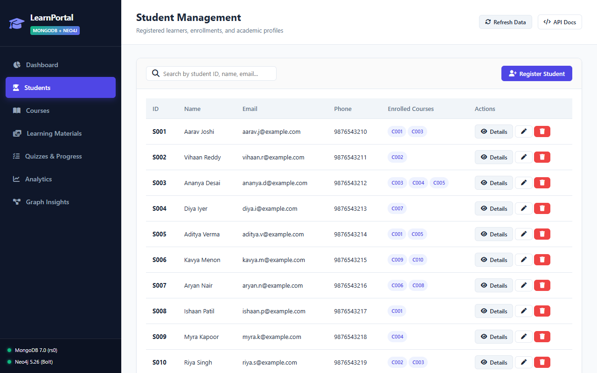
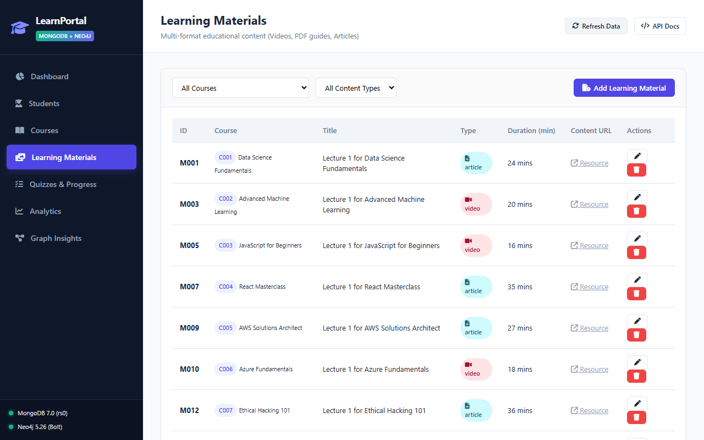
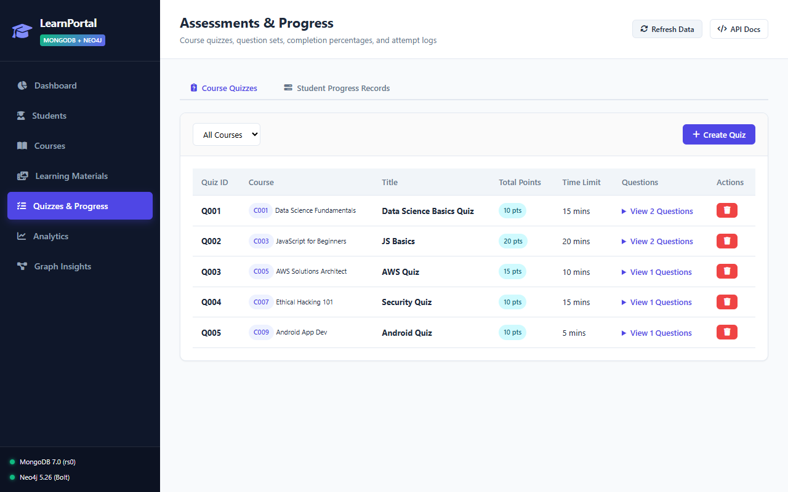
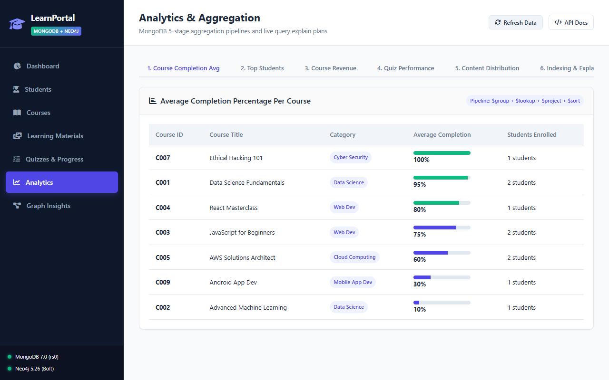

# Online Learning Portal – Full-Stack User Guide

Welcome to the **Online Learning Portal**, an enterprise-grade full-stack web application powered by a hybrid NoSQL architecture combining **MongoDB** (document database) and **Neo4j** (graph database).

This guide walks you through every page, feature, and workflow available in the portal.

---

## 📑 Table of Contents
1. [Portal Architecture Overview](#1-portal-architecture-overview)
2. [Dashboard](#2-dashboard)
3. [Students Management](#3-students-management)
4. [Courses Catalog](#4-courses-catalog)
5. [Learning Materials](#5-learning-materials)
6. [Quizzes & Progress Tracking](#6-quizzes--progress-tracking)
7. [MongoDB Analytics](#7-mongodb-analytics)
8. [Neo4j Graph Insights](#8-neo4j-graph-insights)
9. [End-to-End Practical Workflows](#9-end-to-end-practical-workflows)
10. [Mobile Viewport Support](#10-mobile-viewport-support)

---

## 1. Portal Architecture Overview

The application demonstrates real-world hybrid NoSQL segregation of concerns:
- **MongoDB 7.x (Replica Set `rs0`):** Acts as the operational document store for profile management, JSON Schema-validated documents, course metadata, learning materials, quiz attempts, and complex aggregations.
- **Neo4j 5.x (Cypher Property Graph):** Models multi-hop interconnected relationships including enrollments (`:ENROLLED_IN`), completions (`:COMPLETED`), prerequisite DAGs (`:PREREQUISITE_OF`), instructor teaching assignments (`:TEACHES`), and skill trees (`:HAS_SKILL`, `:REQUIRES_SKILL`).
- **FastAPI Backend (`app/`):** Exposes clean REST endpoints connecting both engines via connection-pooled singletons with ACID transaction handling.
- **Frontend SPA (`app/static/`, `app/templates/index.html`):** A responsive, single-page application built with clean modern CSS, vanilla ES6 JavaScript, live SVG network visualizations, and real-time status indicators.

---

## 2. Dashboard

### Key Features
- **Live Database Telemetry:** Real-time health monitors in the header display MongoDB (`replica_set:rs0`) and Neo4j (`bolt://localhost:7687`) latency and connection status.
- **KPI Metrics Cards:** Instant counts showing active students, published courses, graph nodes, and relationships.
- **Course Completion Distribution:** Interactive visual progress indicator showing student completion rate bands.
- **Quick Action Links:** Direct jump buttons to register students, create courses, run analytics, and inspect prerequisite graphs.
- **System Activity Feed:** Chronological log of recent operations and database events.

---

## 3. Students Management

### Features & Capabilities
- **Search & Filter:** Instant client-side search across student names, IDs, and email addresses.
- **Student Profile View:** Clicking **Details** opens a comprehensive profile modal detailing:
  - Personal contact details and enrollment timestamp.
  - Active course enrollments stored in MongoDB.
  - Graph relationships fetched in real-time from Neo4j (enrolled courses, completed courses, and acquired skills).
- **Direct Enrollment:** Enroll students in any course directly from their profile view or via the inline enrollment action.
- **Student Registration:** Click **+ Add Student** to open the modal form. Validates email formats and unique student IDs before persisting to MongoDB and synchronizing the graph node to Neo4j.
- **Safe Student Deletion:** Clicking the delete button prompts for confirmation, removes the document from MongoDB, and detaches associated graph edges in Neo4j.

---

## 4. Courses Catalog

### Features & Capabilities
- **Multi-Factor Filtering:** Filter courses dynamically by Category (*Computer Science*, *Data Science*, *Web Development*) and Difficulty (*Beginner*, *Intermediate*, *Advanced*).
- **Course Details Dialog:** View instructor profile, credit hours, price, and prerequisite requirements.
- **Course Creation:** Modal form supporting title, category, instructor assignment, price, duration, and difficulty level.
- **Course Deletion:** Removes course metadata from MongoDB while cleaning up prerequisite chains and enrollment edges in Neo4j.

---

## 5. Learning Materials

### Features & Capabilities
- **Content Type Filtering:** Filter learning resources by format:
  - 🎥 **Video Lectures** (with durations in minutes)
  - 📄 **PDF Slides & Textbooks**
  - 📝 **Markdown Notes & Coding Labs**
- **Material Creation:** Add new course modules and bind them to existing course IDs with verified URL resources.
- **Direct Access:** Click external links to inspect learning material content paths.

---

## 6. Quizzes & Progress Tracking

### Features & Capabilities
- **Two Tabbed Perspectives:**
  1. **Student Progress Tracker:** Live overview of completion percentages per student-course pairing. Includes an **Adjust Progress** modal slider (0% to 100%) that updates the MongoDB progress collection in real time.
  2. **Assessment Quizzes Catalog:** View configured quizzes, question counts, and maximum points.
- **Quiz Configuration Modal:** Easily add new quizzes tied to courses, specifying total points, question count, and passing threshold.

---

## 7. MongoDB Analytics

This section demonstrates 5 complex MongoDB Aggregation Pipelines and live query performance analysis:

1. **Average Completion Percentage Per Course:**
   - *Pipeline:* `$group` + `$lookup` + `$project` + `$sort`
   - Computes weighted completion averages joined with course metadata.
2. **Top Students by Completed Courses:**
   - *Pipeline:* `$match` + `$group` + `$sort` + `$limit` + `$lookup`
   - Identifies leading portal learners based on verified course completion status.
3. **Course Revenue Analysis:**
   - *Pipeline:* `$unwind` + `$group` + `$lookup` + `$multiply` + `$sort`
   - Calculates total potential and realized revenue per course offering.
4. **Quiz Performance Analysis:**
   - *Pipeline:* `$unwind` + `$group` + `$lookup` + `$avg` + `$sort`
   - Computes student score distributions and average grades across all quiz attempts.
5. **Content Distribution by Type:**
   - *Pipeline:* `$group` + `$count` + `$sort`
   - Visualizes material composition across video, PDF, and notes.
6. **Indexing & Query Execution Plans:**
   - Live execution stage comparison contrasting **`COLLSCAN`** (unindexed collection scan) vs **`IXSCAN`** (B-tree index scan), highlighting execution time and documents examined.

---

## 8. Neo4j Graph Insights

This section demonstrates the unique capabilities of Neo4j graph traversals and Cypher queries:

1. **Prerequisite Chain Explorer:**
   - Evaluates variable-length dependency trees (`[:PREREQUISITE_OF*1..]`).
   - Select a target course (e.g. *C004 – Deep Learning Specialization*) to uncover all required precursor courses and maximum path depth.
2. **Learning Path Finder:**
   - Runs Cypher's `shortestPath()` algorithm between any two courses in the catalog.
   - Shows the optimal ordered sequence of courses a student must complete to achieve their goal.
3. **Collaborative Filtering Recommendations:**
   - Evaluates peer cohort overlaps: *"Students who enrolled in courses similar to student S001 also enrolled in..."*.
   - Ranks recommended courses with peer count metrics.
4. **Skill Gap Analysis:**
   - Compares the skills required by a student's active enrollments against the skills the student has already acquired (`:HAS_SKILL`).
   - Highlights exact missing competencies needed for graduation.
5. **Graph Analytics:**
   - Course Popularity tables (aggregate `:ENROLLED_IN` + `:COMPLETED` relationships).
   - Instructor Teaching Workload and student reach rankings.

---

## 9. End-to-End Practical Workflows

### Workflow A: Onboarding a New Student & Enrolling in a Course
1. Navigate to **Students** from the left sidebar.
2. Click **+ Add Student**.
3. Enter ID `S011`, Name `Kavita Krishnan`, Email `kavita.k@portal.edu`, and Phone `9876543210`.
4. Click **Register Student**. The new student row appears immediately.
5. Click the **Details** button on the new student's row.
6. Under **Quick Enroll**, choose `C001 – Python Programming Fundamentals` and click **Enroll**.
7. Both MongoDB (`courses_enrolled` array) and Neo4j (`[:ENROLLED_IN]` relationship) are atomically updated.

### Workflow B: Updating Course Completion Progress
1. Navigate to **Quizzes & Progress** from the left sidebar.
2. On the **Student Progress** tab, locate a student record.
3. Click **Adjust** on the record.
4. Move the slider to `100%` and click **Update Progress**.
5. The progress bar updates to green (100%), and the completion is reflected in both MongoDB aggregations and Neo4j `:COMPLETED` edges.

### Workflow C: Exploring Career Recommendations & Skill Gaps
1. Navigate to **Neo4j Graph** from the left sidebar.
2. Switch to the **Recommendations & Skills** sub-tab.
3. Select student `S001 – Aarav Sharma` and click **Get Recommendations**.
4. Review the top recommended courses ranked by peer similarity.
5. Click **Analyze Gaps** to see which prerequisite skills are still missing.

---

## 10. Mobile Viewport Support

The application includes responsive CSS media queries for smartphones and tablets:
- **Horizontal Scrolling Navbar:** Replaces the fixed desktop sidebar with a touch-friendly navigation strip.
- **Responsive Stacking:** Multi-column grids automatically collapse into single-column cards on viewports under `768px`.
- **Horizontal Table Scrolling:** Preserves wide tables without clipping text or controls.
- **Fluid Modals:** Dialog boxes dynamically scale to fit mobile screen widths with touch-friendly tap targets.
